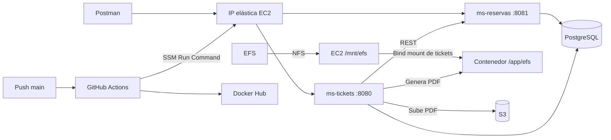

# Sistema de Reservas de Eventos y Tickets

Backend Spring Boot con generación de PDF, almacenamiento temporal en **EFS**, subida automática a **S3** y despliegue en **EC2 con GitHub Actions**.

> **Empieza aquí: [Guía de instalación AWS desde cero](GUIA_EVALUACION.md).**
>
> El código está implementado. Debes crear los recursos en tu cuenta y configurar GitHub siguiendo la guía.

## Documentación

| Orden | Documento | Contenido |
|---|---|---|
| 1 | **[AWS desde cero](GUIA_EVALUACION.md)** | Crear red, S3, roles, EC2, IP elástica y EFS; desplegar |
| 2 | **[Pruebas Postman](docs/POSTMAN.md)** | Importar colección y demostrar cada función |
| 3 | **[Video y entrega](docs/VIDEO_Y_ENTREGA.md)** | Evidencias de la pauta y documentación |
| Consulta | [Arquitectura](docs/ARQUITECTURA.md) | Datos, estados y decisiones |
| Consulta | [Validación](docs/VALIDACION.md) | Pruebas ejecutadas y verificaciones pendientes en AWS |

**Para leer con formato:** GitHub renderiza estos archivos automáticamente. En VS Code abre la paleta de comandos y selecciona **Markdown: Open Preview** para ver títulos, tablas y bloques de código.

## Funcionalidades implementadas

- [x] Eventos, reservas, control de cupos y pagos simulados.
- [x] Generación de tickets PDF personalizados.
- [x] Escritura del PDF en EFS y subida automática a S3.
- [x] Subida explícita y reintento sin duplicar tickets.
- [x] Descarga de PDF y ZIP por usuario o evento.
- [x] Modificación del PDF y reemplazo en la misma clave S3.
- [x] Eliminación de archivos conservando el registro histórico.
- [x] Historial paginado por evento, usuario, fechas y estado.
- [x] Estadísticas de reservas, ventas e ingresos.
- [x] Verificación de integridad con SHA-256.
- [x] Dockerfiles, workflow, scripts EC2 y colección Postman.

`ms-administracion-archivos` conserva el ejemplo original. Los servicios implementados son **ms-reservas** y **ms-tickets**.

## Arquitectura



**Doble montaje:** EFS se monta en `/mnt/efs` de EC2. Docker comparte `/mnt/efs/tickets` dentro de Tickets como `/app/efs`.

## Ejecutar en tu computador

Este modo usa **H2 persistente** y **S3 simulado en disco**. Permite probar las API antes de crear AWS; la evidencia real de EFS/S3 se obtiene en EC2.

### 1. Requisitos

- JDK 21 o superior compatible con Spring Boot 3.5.
- Git y Postman.
- Internet para descargar dependencias la primera vez.

Maven Wrapper ya está incluido. El proyecto compila para Java 21; Boot 3.5.16 admite Java 17–25. [Compatibilidad oficial](https://docs.spring.io/spring-boot/3.5/system-requirements.html).

### 2. Compilar y ejecutar las pruebas

Desde la raíz, en macOS/Linux:

```bash
chmod +x mvnw
./mvnw clean verify
```

En Windows usa `mvnw.cmd clean verify`.

### 3. Encender ambos servicios

En macOS/Linux:

```bash
bash scripts/run-local.sh
```

Deja la terminal abierta. `Ctrl+C` detiene los servicios.

En Windows abre dos terminales, ambas desde la raíz:

```powershell
java -jar ms-reservas/target/ms-reservas-1.0.0.jar --spring.profiles.active=local
```

```powershell
java -jar ms-tickets/target/ms-tickets-1.0.0.jar --spring.profiles.active=local
```

| Servicio | Comprobación |
|---|---|
| Reservas | `http://localhost:8081/actuator/health` |
| Tickets | `http://localhost:8080/actuator/health` |

Ambos deben responder `{"status":"UP"}`. Los datos locales se conservan en `.local/`, excluido de Git.

### 4. Probar las API

Importa la colección y el entorno **Local** según [POSTMAN.md](docs/POSTMAN.md). Con los servicios encendidos también puedes ejecutar:

```bash
python3 scripts/smoke.py
```

## Endpoints

### Reservas — puerto 8081

| Método | Ruta | Función |
|---|---|---|
| POST | `/api/eventos` | Crear evento |
| GET | `/api/eventos/{id}` | Consultar evento |
| POST | `/api/reservas` | Crear reserva |
| GET | `/api/reservas/{id}` | Consultar reserva |
| PATCH | `/api/reservas/{id}/estado` | Pagar o cancelar |
| GET | `/api/eventos/{id}/estadisticas` | Reservas, ventas e ingresos |

### Tickets — puerto 8080

| Método | Ruta | Función |
|---|---|---|
| POST | `/api/tickets` | Generar PDF en EFS y subir a S3 |
| GET | `/api/tickets/{id}` | Consultar metadatos |
| POST | `/api/tickets/{id}/s3` | Subir o reintentar |
| GET | `/api/tickets/{id}/archivo` | Descargar PDF desde S3 |
| GET | `/api/tickets/descarga?usuarioId=...` | ZIP del usuario |
| GET | `/api/tickets/descarga?eventoId=...` | ZIP del evento |
| PUT | `/api/tickets/{id}` | Modificar titular y asiento |
| DELETE | `/api/tickets/{id}` | Eliminar PDF de EFS y S3 |
| GET | `/api/tickets` | Historial paginado y filtrado |

Filtros: `eventoId`, `usuarioId`, `desde`, `hasta`, `estadoArchivo`, `page`, `size`. Fechas UTC: `desde` inclusivo y `hasta` exclusivo.

## Estructura

```text
├── README.md
├── GUIA_EVALUACION.md             # Instalación AWS desde cero
├── ms-reservas/                   # Eventos, reservas y estadísticas
├── ms-tickets/                    # PDF, EFS, S3 e historial
├── ms-administracion-archivos/     # Ejemplo original
├── .github/workflows/ci-cd.yml     # Pruebas, imágenes y despliegue
├── deploy/                       # Preparación EC2, despliegue e IAM
├── postman/                      # Colección y entornos Local/AWS
├── scripts/                      # Arranque local y prueba REST
└── docs/                         # Pruebas, video y diseño
```

## Alcance

Proyecto académico: una EC2 y una réplica de cada servicio. Acceso HTTP limitado a las IP de los integrantes mediante el security group. No incluye autenticación de usuarios ni pasarela de pagos; `PAGADA` registra un pago simulado.

El despliegue recrea contenedores con una interrupción breve. PostgreSQL conserva datos en un volumen Docker sobre EBS. Las imágenes se identifican con el SHA del commit.
